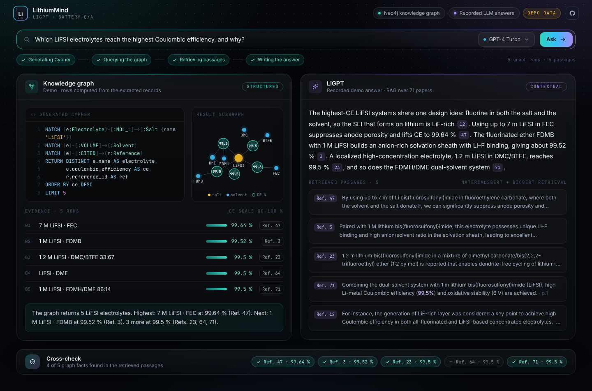

# Lithium-GPT
LithiumMind - Leveraging Language Models for Understanding Battery Performance

Submission for LLM Hackathon for Applications in Materials and Chemistry

## Overview

Videos of the original 2024 hackathon front end: [front end](https://drive.google.com/file/d/1_ZFj8VcUbT_thbjsd1bMfm5z5EKg91vk/view?usp=sharing), [server](https://drive.google.com/file/d/1MX3PX1y-q66N8C3crfuOfKPvwTkOrhku/view?usp=sharing)

LLM for Lithium Batteries' Electrolyte Design
Advanced Chatbot for Lithium Battery Q/A

## Features
- **Two answers to every question, side by side:** a knowledge-graph answer (the LLM writes Cypher, Neo4j returns ranked Coulombic efficiency facts with their source papers) and a retrieval-augmented LLM answer that cites the passages it used
- **Cross-check:** each graph fact is checked against the retrieved passages, and the page shows which CE values appear in the source text
- **Pick the model per question:** any OpenAI or Anthropic model listed in `LLM_MODELS`, for example GPT-4 Turbo or Claude Opus 5.5
- **Demo mode** (`?demo`): runs without the server, on the 167 records extracted from the papers in `database/extracted_info/`, with recorded LLM answers for the example questions

## Installation

To run this project locally, follow these steps:

### Front end

npm install

npm run dev

Open [http://localhost:5173/](http://localhost:5173/) (talks to the Flask server on port 8080; set `VITE_API_URL` to use another address), or [http://localhost:5173/?demo](http://localhost:5173/?demo) to try it without the server.

### Flask server

Install the Python dependencies (the embedding models run on a CUDA GPU, `cuda:0`; Claude support needs Python 3.10 or later):

pip install -r requirements.txt

Copy `.env.example` to `src/service/front_end/.env` and fill in your keys and Neo4j connection (the notebooks read a `.env` in the repository root). Never commit `.env`.

cd src/service/front_end

python li_gpt_server.py

### Choosing models

`LLM_MODELS` in `.env` lists the models the page offers, as `provider:model` entries; the first is the default:

LLM_MODELS=openai:gpt-4-turbo,anthropic:claude-opus-5-5

- `openai:<model>` uses `OPENAI_API_KEY`. Requests are sent with temperature 0; reasoning models that only accept temperature 1 need `OPENAI_TEMPERATURE=1`.
- `anthropic:<model>` uses `ANTHROPIC_API_KEY` and the official Anthropic SDK. No sampling parameters are sent, since current Claude models reject them. Claude Opus 5.5, Opus 5, Sonnet 5.5 and Fable 5.1 requests turn on Anthropic's server-side refusal fallback (`fallbacks: "default"`), which reruns a declined request on another model. `ANTHROPIC_EFFORT` (`low` to `max`) sets the effort level; Claude Opus 5.5 defaults to `medium`.
- The retrieval step still uses OpenAI embeddings, so `OPENAI_API_KEY` is needed with either provider.

The server exposes `GET /models` and `POST /process-data` with `{"query": ..., "model": ...}`; the response carries the Cypher steps, both answers, the retrieved passages (`li_gpt_sources`) and the model used.

## Demo video

`video.html` is a motion-design walkthrough built from the real extraction results: open [http://localhost:5173/video.html](http://localhost:5173/video.html) while `npm run dev` is running (`?t=20` freezes one moment). To render it to MP4 (needs Playwright and ffmpeg):

npm i -D playwright

node scripts/render-video.mjs --out demo.mp4

The page in the video runs in demo mode: graph rows are computed from the extracted records and the LLM answer is a recorded one, labelled as such on screen.

## Technologies Used
- Vite.js, React, Tailwind CSS, d3-force
- Python, Flask
- LangChain
- OpenAI and Anthropic models
- Neo4j

## Contributing

We welcome contributions from the community! If you'd like to contribute to enhancing this web app, please follow these guidelines:

Reporting Issues
If you encounter any bugs or issues while using the web app, please open an **issue** on GitHub. Be sure to include detailed steps to reproduce the issue and any relevant information about your environment.

Feature Requests
If you have ideas for new features or improvements, we'd love to hear them! Open an issue to share your suggestions. Describe the feature you'd like to see and why it would be valuable to the project.

Pull Requests
We encourage you to submit pull requests with fixes or enhancements. To contribute code to the project, follow these steps:

Fork the repository and create a new branch for your feature or fix.
Make your changes, ensuring that your code follows the project's coding standards.
Test your changes thoroughly to ensure they work as expected.
Submit a pull request to the main branch of the original repository, explaining the purpose of your changes.
Before submitting a pull request, please ensure that:

Your code passes any existing tests.
You've added appropriate documentation for any new features or changes.
Your commits follow the conventional commit message format (e.g., "feat: Add new feature", "fix: Correct issue with...")
You've updated the README with any necessary information about your changes.
Code Style
Please follow the existing code style and formatting conventions when making changes to the codebase. If you're unsure about the style, feel free to ask for guidance.

## Errata
The LithiumMind write-up in the hackathon report ([arXiv:2411.15221](https://arxiv.org/abs/2411.15221)) gives 334 CE–electrolyte pairs extracted from 71 papers. That number matches the output of the record loader in `build_kg.ipynb`, which added every extracted record twice. The files in `database/extracted_info/` hold 167 records (164 unique, 147 with a CE value). The loader is now fixed, so a knowledge graph built from this repository no longer gets duplicate electrolyte nodes. The 46 matches with the original dataset reported in the write-up have not been rechecked.

## License
MIT

## Acknowledgements
Xinyi Ni, Zizhang Chen, Rongda Kang, Sheng-Lun (Mark) Liao, Pengyu Hong, Sandeep R. Madireddy

The front-end UI is adapted from a ChatGPT clone UI by mayeskhatri243.

## Contact
Xinyi Ni, Zizhang Chen, Rongda Kang, Sheng-Lun (Mark) Liao, Pengyu Hong, Sandeep R. Madireddy

rongdakangkk@gmail.com
